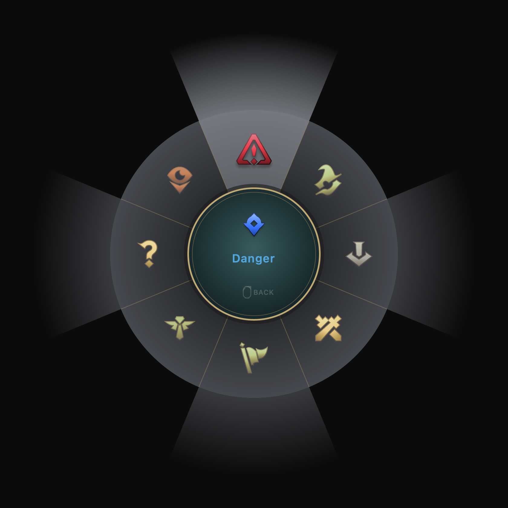
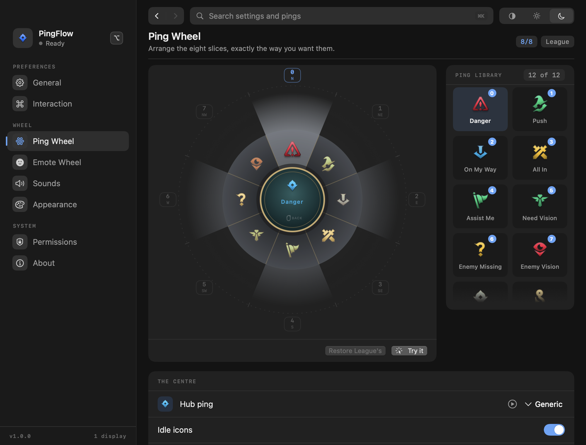
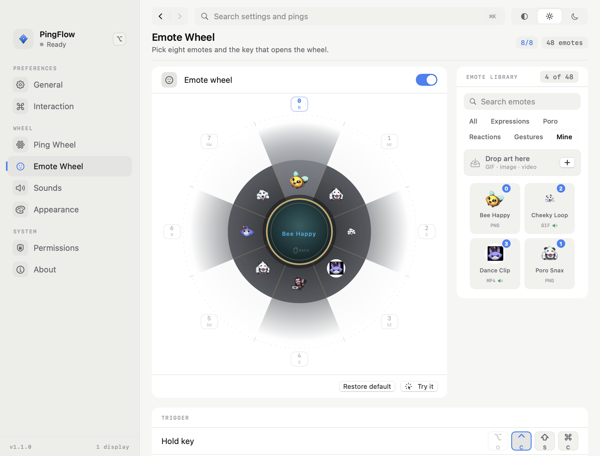
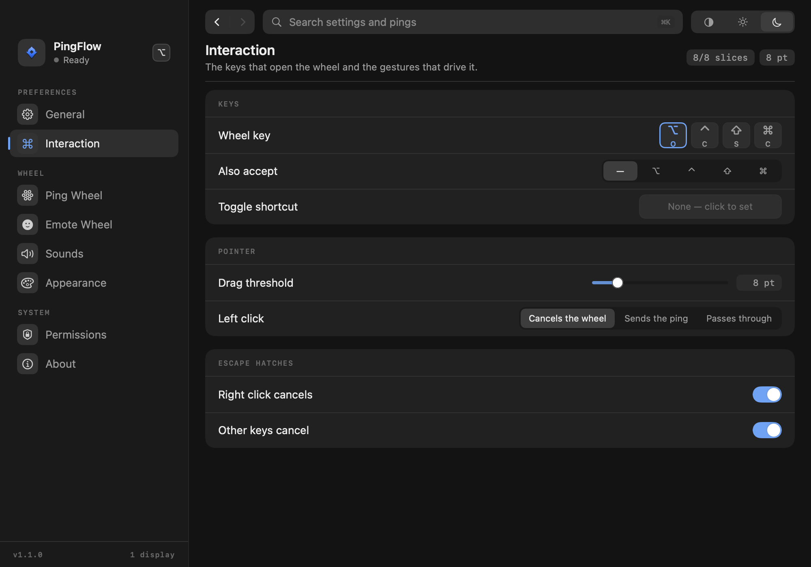
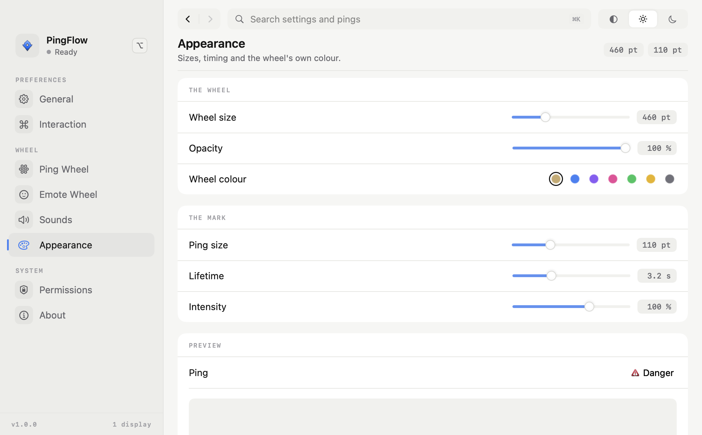
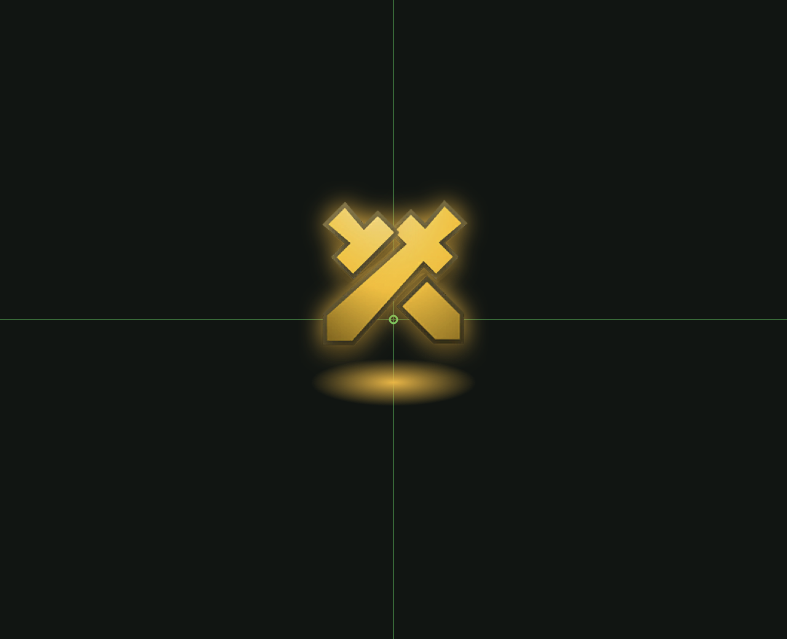

# PingFlow

<p align="center">
  
</p>

<p align="center">
  <a href="https://github.com/williamcachamwri/PingFlow/actions/workflows/build.yml"></a>
  <a href="https://github.com/williamcachamwri/PingFlow/releases/latest"></a>
  
  
  
</p>

> A native macOS ping wheel for League of Legends. Hold **⌥** anywhere on screen, a wheel opens
> under the cursor, move to a slice, release **⌥** — the original ping animation plays on the overlay
> and the original ping sound plays. Hold **⌃** for the second wheel: 44 real emotes, same gesture.
> Nothing else about the machine changes: no Electron, no WebView, no window that stays open. The app
> lives in the menu bar.

**[Download the latest release](https://github.com/williamcachamwri/PingFlow/releases/latest)** ·
Swift 6 · SwiftUI + AppKit + Core Animation + AVFAudio · macOS 13+

---

## Contents

| | |
| --- | --- |
| [Install](#install) | first run, the one permission, the stale grant |
| [Build and test](#build-and-test) | three commands, 77 tests |
| [The settings window](#the-settings-window) | eight pages, two wheels, no save button |
| [Architecture](#architecture) | eight modules and why the tap is listen-only |
| [Assets and licensing](#assets-and-licensing) | whose art this is |
| [Checking the UI without opening it](#checking-the-ui-without-opening-it) | four headless render modes |

---

## Install

```sh
./Support/build_app.sh          # → build/PingFlow.app (ad-hoc signed, hardened runtime)
```

1. Drag `PingFlow.app` to `/Applications` and open it once. No window appears; the icon is in the
   menu bar.
2. **Privacy & Security → Accessibility → PingFlow**, switch it on. The app polls every 1.5 s, so the
   wheel works the moment the switch flips — no relaunch. The Permissions page has the buttons and
   the retry.
3. Hold **⌥**, move, release over a slice. Hold **⌃** for the emote wheel. **⌃⌥P** enables or
   disables PingFlow entirely.
4. Launch at login is a switch on the General page and uses `SMAppService`, so it survives a reboot.

> [!TIP]
> The build is ad-hoc signed and not notarised, so Gatekeeper stops a downloaded copy on the first
> double-click. Right-click → **Open** gets past it. An updated bundle can also leave a stale entry
> in the Accessibility list: remove PingFlow, re-add it with **+**, and it works again.

## Build and test

```sh
swift build                      # debug
swift build -c release           # production
swift test                       # 77 tests: geometry, wheel editor, scenes, input, settings
./Support/build_app.sh --universal   # the .app that CI releases (arm64 + x86_64)
```

The tests cover the parts that are pure logic — radial hit-testing, sector ordering, the state
machine, slot swapping, keyboard decoding, settings round-tripping and validation. They never touch
the event tap or the screen. Every push runs them on a macOS runner and packages the app; a `v*` tag
attaches the result to a release. See [`.github/workflows/build.yml`](.github/workflows/build.yml).

## The settings window

Eight pages in three sidebar groups. One accent; cards separate by fill rather than by border, and
hairlines only run inside a card. Changes apply as you make them, so there is no save button and no
*Autosaved* toast. Every page renders in both themes.

| Group | Page | What it decides |
| --- | --- | --- |
| Preferences | General | Enable, launch at login, the menu bar and Dock icons, reset |
| Preferences | Interaction | The wheel key, the toggle shortcut, the drag threshold, the cancel hatches |
| Wheel | Ping Wheel | Which ping sits on each of the eight slices |
| Wheel | Emote Wheel | Which emote sits on each of the eight slices |
| Wheel | Sounds | Master volume, mute, whether pings make a noise, the hover tick |
| Wheel | Appearance | Wheel size, opacity, colour, and the mark's size, lifetime, intensity |
| System | Permissions | The Accessibility grant and the retry |
| System | About | Version, build and the asset inventory on disk |

The two wheel pages share one shape: the live wheel on the left, its library on the right, and the
settings for that wheel in a card underneath. Assignment is drag-only — the plate on each spoke is
already the slice's index and compass, so there is no separate slice list to keep in step.

| Ping Wheel | Emote Wheel |
| --- | --- |
|  |  |

**Interaction** records keys natively: click, press a combination, the keycaps render, **Esc**
cancels, and a combination macOS cannot deliver globally — or one already bound — is refused with a
message rather than silently accepted.



**Appearance** drives the wheel itself: size, opacity and colour, then the mark's size, lifetime and
intensity, each with the value written next to the handle.



## Architecture

Eight things that do not know about each other's internals, joined by `PingFlowEngine`:

| Concern | Files | Notes |
| --- | --- | --- |
| Ping model | `Core/PingDefinition.swift`, `Core/EmoteDefinition.swift` | 12 pings (id, wheel label, colour, texture, sound, animation kind) and 44 emotes in four categories, each with its own texture and voice line. |
| Wheel geometry | `Core/WheelGeometry.swift` | Pure math. Eight slices, dead zone, angle → slice, no AppKit import. |
| Settings | `Core/Settings.swift` | One `Codable` value in `UserDefaults`; every field falls back instead of throwing. |
| Assets | `Core/AssetCatalog.swift` | Resolves `Contents/Resources/Assets` in the bundle, or `Assets/` in the repo when running from `.build`. |
| Input | `Input/EventTap.swift`, `InputCoordinator.swift`, `Keys.swift`, `PermissionManager.swift` | A `CGEventTap` on key/mouse events, plus `AXIsProcessTrusted()` polling. |
| Overlay | `Overlay/OverlayController.swift`, `OverlayHost.swift`, `WheelOverlayView.swift`, `WheelScene.swift`, `PingWheelView.swift`, `PingFxContainerView.swift` | Non-activating `NSPanel`s, one per screen, click-through, `canJoinAllSpaces`. |
| Audio | `Audio/AudioEngine.swift` | `AVAudioEngine` with pre-loaded buffers, so the first ping of a session has no disk hit. |
| UI | `UI/Settings/*`, `UI/Design/*`, `MenuBar/MenuBarController.swift` | The eight-page settings window and the menu bar menu. |

The wheel and the ping animation are separate systems. The wheel is a SwiftUI `Canvas` driven by a
`WheelScene` observable object; the scene is updated by pointer deltas, never rebuilt, so moving the
cursor allocates no views. The ping animation is Core Animation layers built once per ping in
`PingFxContainerView` — ring, ground ellipse, icon, bob and clash sub-layers — with keyframe
animations on the render server, so it holds 60 FPS without a display-link loop and several pings
can overlap.

Input never swallows ordinary use, and the reason is structural: the event tap is created with
`.listenOnly`, so macOS will not let it modify or drop an event even if the code tried. PingFlow only
watches for the activation modifier arriving and leaving (`.flagsChanged`, with the mouse event flags
as the fallback that secure fields do not block) and for its own toggle combination. It stops
watching entirely the moment PingFlow is disabled.

## Assets and licensing

Textures and sounds are the game's own, extracted from local League data with the tooling in the
reference repository ([darrenprx/lolPing](https://github.com/darrenprx/lolPing)), and stored under
`Assets/textures` (29 files), `Assets/sounds` (22 files) and `Assets/emotes` (88 files — 44 icons
with their 44 voice lines). `Assets/ATTRIBUTION.md` records provenance and ships inside the bundle.

> [!CAUTION]
> **League of Legends art and audio belong to Riot Games.** PingFlow is not affiliated with, endorsed
> by, or sponsored by Riot Games, and the app's MIT source licence says nothing about these files.
> Take the release for your own machine; do not redistribute the bundle. Delete the `Assets` folder
> inside it and the wheel falls back to drawn placeholders, with no game art on disk at all.

## Checking the UI without opening it

`--render-settings`, `--render-wheel` and `--render-ping` write PNGs from an off-screen window at
(-4000, -4000) — nothing appears on your screen, and the same view code paths run:

```sh
.build/debug/PingFlow --render-settings --pane appearance --appearance dark --out /tmp/a.png
.build/debug/PingFlow --render-wheel --wheel-size 540 --out /tmp/wheel.png
.build/debug/PingFlow --render-ping --ping allin --size 640x520 --out /tmp/ping.png
```

The ping render draws a crosshair at the exact spawn point, so the animation's position is
measurable rather than eyeballed.



`demo/` holds the six shots this file embeds; re-render each one with `--out demo/<name>.png`.
`--live-wheel` is the fourth mode: it photographs the real overlay on screen instead of an
off-screen copy of it.

---

<p align="center">
  <sub>From-scratch Swift implementation. The geometry constants, animation timings and asset naming
  follow the MIT-licensed <a href="https://github.com/darrenprx/lolPing">lolPing</a> as a technical
  specification; no Electron or TypeScript source is translated or wrapped.</sub>
</p>
