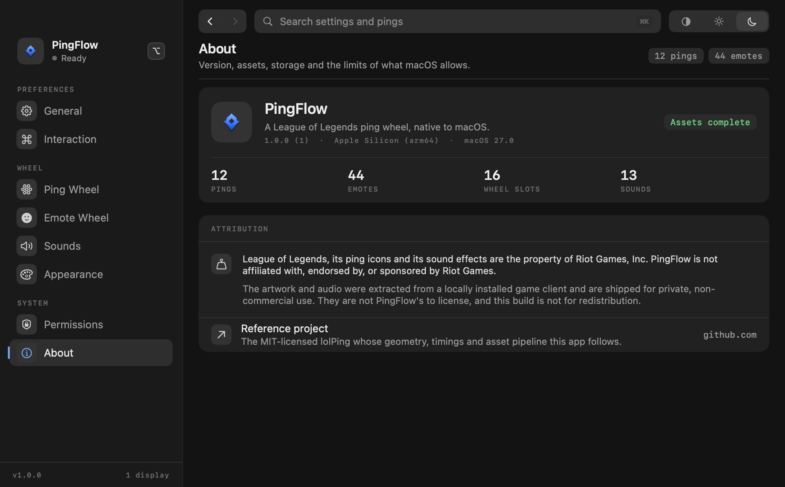

# PingFlow

<p align="center">
  
</p>

A native macOS ping wheel for League of Legends. Hold **⌥** anywhere on screen, a wheel opens
under the cursor, move to a slice, release **⌥** — the original ping animation plays on the overlay
and the original ping sound plays. Hold **⌃** for the second wheel: 44 real emotes, same gesture.
Nothing else about the machine changes: no Electron, no WebView, no window that stays open. The app
lives in the menu bar.

Swift 6 · SwiftUI + AppKit + Core Animation + AVFAudio · Apple Silicon · macOS 13+

---

## Install

```sh
./Support/build_app.sh          # → build/PingFlow.app (arm64, ad-hoc signed, hardened runtime)
```

1. Drag `build/PingFlow.app` to `/Applications` and open it once. No window appears; the icon is in
   the menu bar.
2. **Privacy & Security → Accessibility → PingFlow**, switch it on. The app polls every 1.5 s, so the
   wheel works the moment the switch flips — no relaunch. The Permissions page has the buttons and
   the retry.
3. Hold **⌥**, move, release over a slice. Hold **⌃** for the emote wheel. **⌃⌥P** enables or
   disables PingFlow entirely.
4. Launch at login is a switch on the General page and uses `SMAppService`, so it survives a reboot.

Because the build is ad-hoc signed rather than notarised, an updated bundle can leave a stale entry
in the Accessibility list. Remove PingFlow from that list, re-add it with **+**, and it works again.

## Build and test

```sh
swift build                      # debug
swift build -c release           # production
swift test                       # 77 tests: geometry, wheel editor, scenes, input, settings
```

The tests cover the parts that are pure logic — radial hit-testing, sector ordering, the state
machine, slot swapping, keyboard decoding, settings round-tripping and validation. They never touch
the event tap or the screen.

## Architecture

Eight things that do not know about each other's internals, joined by `PingFlowEngine`:

| Concern | Files | Notes |
| --- | --- | --- |
| Ping model | `Core/PingDefinition.swift`, `Core/EmoteDefinition.swift` | 12 pings (id, wheel label, colour, texture, sound, animation kind) and 44 emotes in four categories, each with its own texture and voice line. |
| Wheel geometry | `Core/WheelGeometry.swift` | Pure math. Eight slices, dead zone, angle → slice, no AppKit import. |
| Settings | `Core/Settings.swift` | One `Codable` value in `UserDefaults`; every field falls back instead of throwing. |
| Assets | `Core/AssetCatalog.swift` | Resolves `Contents/Resources/Assets` in the bundle, or `Assets/` in the repo when running from `.build`. |
| Input | `Input/EventTap.swift`, `InputCoordinator.swift`, `Keys.swift`, `PermissionManager.swift` | A `CGEventTap` on key/mouse events, plus `AXIsProcessTrusted()` polling. |
| Overlay | `Overlay/OverlayController.swift`, `OverlayHost.swift`, `WheelOverlayView.swift`, `WheelScene.swift`, `PingWheelView.swift`, `PingFxContainerView.swift` | Non-activating `NSPanel`s, one per screen, click-through, `canJoinAllSpaces`. |
| Audio | `Audio/AudioEngine.swift` | `AVAudioEngine` with pre-loaded buffers, so the first ping of a session has no disk hit. |
| UI | `UI/Settings/*`, `UI/Design/*`, `MenuBar/MenuBarController.swift` | The eight-page settings window and the menu bar menu. |

The wheel and the ping animation are separate systems. The wheel is a SwiftUI `Canvas` driven by a
`WheelScene` observable object; the scene is updated by pointer deltas, never rebuilt, so moving the
cursor allocates no views. The ping animation is Core Animation layers built once per ping in
`PingFxContainerView` — ring, ground ellipse, icon, bob and clash sub-layers — with keyframe
animations on the render server, so it holds 60 FPS without a display-link loop and several pings
can overlap.

Input never swallows ordinary use, and the reason is structural: the event tap is created with
`.listenOnly`, so macOS will not let it modify or drop an event even if the code tried. PingFlow only
watches for the activation modifier arriving and leaving (`.flagsChanged`, with the mouse event flags
as the fallback that secure fields do not block) and for its own toggle combination. It stops
watching entirely the moment PingFlow is disabled.

## The settings window

Eight pages in three sidebar groups — **Preferences** (General, Interaction) · **Wheel** (Ping Wheel,
Emote Wheel, Sounds, Appearance) · **System** (Permissions, About). One accent; cards separate by
fill rather than by border, and hairlines only run inside a card. Changes apply as you make them, so
there is no save button and no *Autosaved* toast. Every page renders in both themes.

The two wheel pages share one shape: the live wheel on the left, its library on the right, and the
settings for that wheel in a card underneath. Assignment is drag-only — the plate on each spoke is
already the slice's index and compass, so there is no separate slice list to keep in step.

| Ping Wheel | Emote Wheel |
| --- | --- |
|  |  |

**Interaction** records keys natively: click, press a combination, the keycaps render, **Esc**
cancels, and a combination macOS cannot deliver globally — or one already bound — is refused with a
message rather than silently accepted.


**Appearance** drives the wheel itself: size, opacity and colour, then the mark's size, lifetime and
intensity, each with the value written next to the handle.


**About** is the inventory the app checked at launch — how many pings, emotes, slots and sounds are
actually on disk, and whose art they are.



## Assets and licensing

Textures and sounds are the game's own, extracted from local League data with the tooling in the
reference repository ([darrenprx/lolPing](https://github.com/darrenprx/lolPing)), and stored under
`Assets/textures` (29 files), `Assets/sounds` (22 files) and `Assets/emotes` (88 files — 44 icons
with their 44 voice lines). `Assets/ATTRIBUTION.md` records provenance and ships inside the bundle.

**League of Legends art and audio belong to Riot Games.** PingFlow is not affiliated with or endorsed
by Riot Games. The app's own source is MIT; that says nothing about the assets. Do not redistribute
this bundle — build it locally for personal use.

## Limits

These are macOS's limits, not the app's, and PingFlow does not pretend otherwise:

- No overlay above another application's **exclusive** full screen. Games in full-screen *window*
  mode are fine; true exclusive mode takes the display away from the window server.
- No overlay above **protected content** (DRM video layers), and screen capture of those surfaces is
  blocked regardless of what PingFlow draws.
- **Secure input** fields — password dialogs, some terminals, some banking apps — hide keystrokes
  from every event tap. While one is focused the wheel simply will not open.
- An ad-hoc signature means the Accessibility grant is tied to this exact bundle on disk; rebuilding
  to a different path can require re-granting.
- The global toggle defaults to Control-Option-P rather than the plain Control-P the brief
  suggested. The tap is listen-only, so Control-P would still reach the focused app — but every
  Control-P in a terminal or readline tool (bash, zsh, python, ssh) would also enable or disable
  PingFlow, which is the opposite of an invisible utility. The recorder will let you bind Control-P
  anyway if you want that trade-off; validation only refuses combinations macOS cannot deliver
  globally.

## Checking the UI without opening it

`--render-settings`, `--render-wheel` and `--render-ping` write PNGs from an off-screen window at
(-4000, -4000) — nothing appears on your screen, and the same view code paths run:

```sh
.build/debug/PingFlow --render-settings --pane appearance --appearance dark --out /tmp/a.png
.build/debug/PingFlow --render-wheel --wheel-size 540 --out /tmp/wheel.png
.build/debug/PingFlow --render-ping --ping allin --size 640x520 --out /tmp/ping.png
```

The ping render draws a crosshair at the exact spawn point, so the animation's position is
measurable rather than eyeballed.


`demo/` holds the seven shots this file embeds; re-render each one with `--out demo/<name>.png`.
`--live-wheel` is the fourth mode: it photographs the real overlay on screen instead of an
off-screen copy of it.
